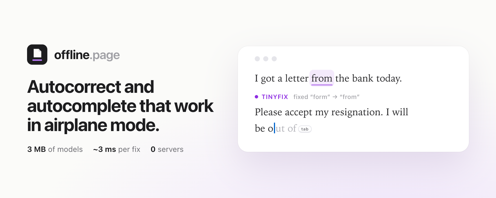

<p align="center">
  <picture>
    <source media="(prefers-color-scheme: dark)" srcset="../brand/banner-dark.png">
    
  </picture>
</p>

<p align="center">
  <a href="https://huggingface.co/spaces/cfahlgren1/offline-page"><b>Open the app</b></a> ·
  <a href="https://huggingface.co/cfahlgren1/tinyfix-realword">tinyfix</a> ·
  <a href="https://huggingface.co/cfahlgren1/enron-autocomplete">tinynext</a>
</p>

**offline.page** is a Markdown writing app with autocorrect and autocomplete that run entirely in your browser tab. Two tiny models, about 3 MB together, no server, and once the page has loaded it keeps working with Wi‑Fi off.

## The models

<table>
  <tr>
    <td width="50%" valign="top">
      <br>
      <b>tinyfix</b> · autocorrect<br>
      <sub>1.9M params · 2.1 MB · ~3 ms per check</sub>
      <p>Fixes misspellings like “recieve” as you finish the word. It also catches real words in the wrong place, like “form” for “from”, by reading the words on both sides, so those fixes land about two words later.</p>
    </td>
    <td width="50%" valign="top">
      <br>
      <b>tinynext</b> · suggestions<br>
      <sub>944K params · 0.98 MB · ~4 ms per suggestion</sub>
      <p>A character-level model that suggests the next few words in gray. Press Tab to take them. It only shows a suggestion when it’s at least 50% sure.</p>
    </td>
  </tr>
</table>

### What to expect

- **Fast, private and offline first, accurate second.** tinyfix catches about a third of wrong-word typos. When it does make a fix, it’s right about 94% of the time.
- **tinynext sounds like a memo.** It was trained on the Enron email corpus. Weights are on the Hub as [`cfahlgren1/enron-autocomplete`](https://huggingface.co/cfahlgren1/enron-autocomplete).
- **Every fix is reversible.** Each one is its own undo step, so Backspace right after a fix undoes it. Purple underlines are fixes from context, blue ones are spelling. Tap one to see what it replaced.

## Features

- Markdown editing on [Tiptap](https://tiptap.dev): headings, lists, quotes, code and dividers, with a `/` menu
- Pages saved in your browser's local storage, with Markdown export and copy
- Light and dark mode
- A service worker that caches the app, the ONNX runtime and both models on the first visit, so later visits load with no network

## How it works

```
keystroke ─▶ Tiptap (ProseMirror) ─┬─▶ tinyfix   word finished? check it, and the word two back
                                   │              └─▶ fix as its own undo step, underlined
                                   └─▶ tinynext  cursor at the end of a line? continue the text
                                                  └─▶ gray text, Tab to accept
```

Both models run with [ONNX Runtime Web](https://onnxruntime.ai/docs/tutorials/web/) on WebAssembly, on the main thread, one request at a time. The first visit downloads about 3 MB of models plus the 11 MB WASM runtime (about 3 MB compressed). After that everything comes from the cache.

## Development

```sh
npm install
npm run dev      # dev server
npm run build    # typecheck, build to dist/, write the offline service worker
npm run brand    # re-render the images in brand/ (set CHROMIUM_PATH, or have Chrome installed)
```

| Path | What's there |
| --- | --- |
| `src/extensions/autocorrect.ts` | When to check words, applying fixes, Backspace to undo |
| `src/extensions/suggestions.ts` | Gray suggested text and Tab to accept |
| `src/extensions/slashMenu.ts` | The `/` block menu |
| `src/tinyfix/` | Dictionary, typo costs and the wrong-word checker |
| `src/autocomplete.ts` | tinynext inference |
| `scripts/write-service-worker.mjs` | Generates the offline cache after each build |
| `brand/` | Marks, banners and the HTML they're rendered from |
