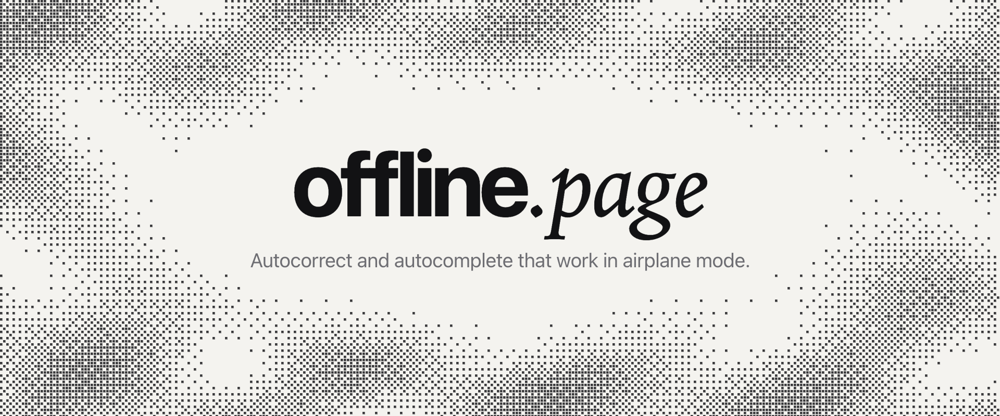
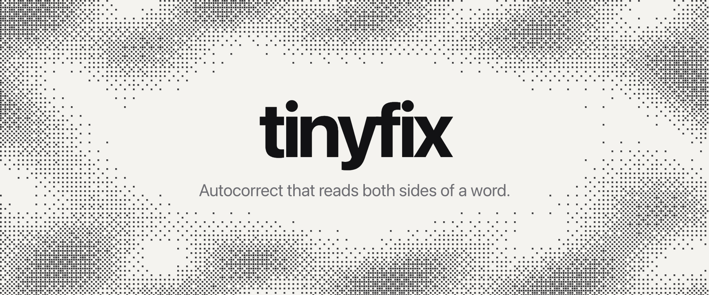

<p align="center">
  
</p>

<p align="center">
  <a href="https://offlinepage.app"><b>Open the app</b></a> ·
  <a href="https://huggingface.co/paperweight/tinyfix">tinyfix</a> ·
  <a href="https://huggingface.co/paperweight/tinynext">tinynext</a>
</p>

**offlinepage.app** is a Markdown writing app with autocorrect and autocomplete that run entirely in your browser tab. Two tiny models, about 15 MB together, no server, and once the page has loaded it keeps working with Wi‑Fi off.

## The models



**[tinyfix](https://huggingface.co/paperweight/tinyfix)** fixes misspellings like “recieve” as you finish the word. It also catches real words in the wrong place, like “form” for “from”, by reading the words on both sides, so those fixes land about two words later.


**[tinynext](https://huggingface.co/paperweight/tinynext)** suggests the next few words in gray. Press Tab to take them. It’s a 12.5M-parameter transformer that reads up to about 1,500 characters before the cursor and the text after it, and only shows a suggestion when it’s at least 40% sure. About two in three suggestions are right.

### What to expect

- **Fast, private and offline first, accurate second.** tinyfix catches about 4 in 10 wrong-word typos. When it does make a fix, it’s right about 94% of the time.
- **tinynext is small, so it stays quiet a lot.** It saves about 4% of typing on articles and email and 9% on chat-style messages. It trained on 3B tokens of web articles, chat and Enron email.
- **Every fix is reversible.** Each one is its own undo step, so Backspace right after a fix undoes it. Purple underlines are fixes from context, blue ones are spelling. Tap one to see what it replaced.

## Features

- Markdown editing on [Tiptap](https://tiptap.dev): headings, lists, quotes, code and dividers, with a `/` menu
- Built with [SvelteKit](https://svelte.dev/docs/kit) and Tailwind, as one page that's turned into plain HTML ahead of time
- Pages saved in your browser's local storage, with Markdown export and copy
- Light and dark mode
- A service worker that caches the app, the ONNX runtime and both models on the first visit, so later visits load with no network

## How it works

```
keystroke ─▶ Tiptap (ProseMirror) ─┬─▶ tinyfix   word finished? check it, and the word two back
                                   │              └─▶ fix as its own undo step, underlined
                                   └─▶ tinynext  cursor at the end of a line? continue the text
                                                  └─▶ gray text, Tab to accept
```

Both models run with [ONNX Runtime Web](https://onnxruntime.ai/docs/tutorials/web/) on WebAssembly. tinyfix runs on the main thread; tinynext runs in a Web Worker, about 5 ms per suggestion, so typing never waits on it. The first visit downloads about 15 MB of models plus the 11 MB WASM runtime (about 3 MB compressed). After that everything comes from the cache.

## Development

```sh
npm install
npm run dev      # dev server
npm run build    # typecheck, build to dist/, write the offline service worker
npm run brand    # re-render the images in brand/ (set CHROMIUM_PATH, or have Chrome installed)
```

| Path                               | What's there                                           |
| ---------------------------------- | ------------------------------------------------------ |
| `src/extensions/autocorrect.ts`    | When to check words, applying fixes, Backspace to undo |
| `src/extensions/suggestions.ts`    | Gray suggested text and Tab to accept                  |
| `src/extensions/slashMenu.ts`      | The `/` block menu                                     |
| `src/tinyfix/`                     | Dictionary, typo costs and the wrong-word checker      |
| `src/tinynext/`                    | tinynext's tokenizer, decoding and Web Worker          |
| `scripts/write-service-worker.mjs` | Generates the offline cache after each build           |
| `brand/`                           | Marks, banners and the HTML they're rendered from      |
